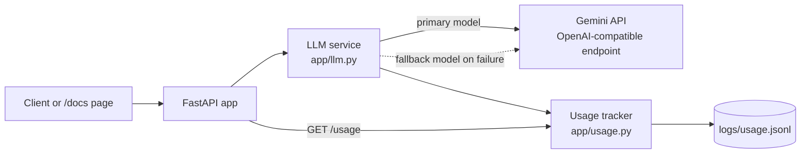

# StreamTrace design

Status: Week 2. Sections marked **current** exist in the code today. Sections marked **planned** are the design for later weeks and may change.

## Overview

StreamTrace answers questions about how a request moves through the Apache Kafka source code. An engineer asks a question, and StreamTrace returns a numbered step list where each step cites a file and line range.

This week's scope is the foundation: a FastAPI service that calls a language model reliably (with a fallback model), tracks tokens and cost, and runs in Docker with CI.



## API endpoints (current)

| Method | Path | Purpose |
| ------ | ---- | ------- |
| GET | `/health` | Liveness check. Fast, never calls the LLM. |
| POST | `/chat` | Send a prompt to the primary model, fall back to the second model if it fails. |
| GET | `/usage` | Totals for calls, tokens and cost, plus the most recent calls. |

### GET /health

Response `200`:

```json
{"status": "ok", "app": "examate-rag", "environment": "local"}
```

### POST /chat

Request:

```json
{"prompt": "Say hello in one sentence", "system": null}
```

- `prompt`: required, 1 to 8,000 characters.
- `system`: optional, up to 4,000 characters.

Response `200`:

```json
{
  "answer": "Hello there!",
  "model": "gemini-2.5-flash",
  "fallback_used": false,
  "prompt_tokens": 8,
  "completion_tokens": 3,
  "cost_usd": 0.0,
  "latency_ms": 2638
}
```

Errors:

| Code | Meaning |
| ---- | ------- |
| 422 | The request body is invalid (for example an empty prompt). |
| 502 | The primary and fallback models both failed. |
| 503 | The LLM is not configured (no API key or primary model). |

### GET /usage

Query parameter `recent` (0 to 100, default 10) sets how many recent calls to return.

Response `200`:

```json
{
  "total_calls": 7,
  "successful_calls": 2,
  "failed_calls": 5,
  "fallback_calls": 3,
  "prompt_tokens": 16,
  "completion_tokens": 12,
  "total_tokens": 28,
  "cost_usd": 0.0,
  "recent": [
    {
      "timestamp": 1793082686.97,
      "role": "fallback",
      "model": "gemini-3.5-flash-lite",
      "ok": true,
      "prompt_tokens": 8,
      "completion_tokens": 9,
      "cost_usd": 0.0,
      "latency_ms": 931,
      "error": null
    }
  ]
}
```

Each model attempt counts as one call, so a request that falls back counts as two.

## LLM calls and fallback (current)

1. `LLMService.complete()` calls the primary model.
2. If the call fails (any error from the API client), the failure is logged and the fallback model is tried.
3. If both fail, the endpoint returns `502`.
4. The provider is any OpenAI-compatible API. It is set by `LLM_BASE_URL`. Today it is Google's Gemini endpoint.
5. The client does not retry on its own (`max_retries=0`), so a failure moves to the fallback straight away.
6. The log stores only the error class name, never the API key or the prompt text.

## Data

### Usage log (current)

One JSON object per line in `logs/usage.jsonl`. The file is read at startup so totals survive a restart. It is not committed to Git.

| Field | Type | Meaning |
| ----- | ---- | ------- |
| `timestamp` | float | Unix time of the call. |
| `role` | string | `primary` or `fallback`. |
| `model` | string | Model name that was called. |
| `ok` | bool | Whether the call succeeded. |
| `prompt_tokens` | int | Input tokens (0 on failure). |
| `completion_tokens` | int | Output tokens (0 on failure). |
| `cost_usd` | float | Tokens times the configured price per million tokens. |
| `latency_ms` | int | Time taken by the call. |
| `error` | string or null | Error class name when `ok` is false. |

### Planned tables (Week 3 and later)

These are a first draft and will change once ingestion is built.

**`chunks`**: one row per piece of Kafka source code.

| Column | Type | Notes |
| ------ | ---- | ----- |
| `id` | integer | Primary key. |
| `module` | text | For example `clients`, `core`, `storage`. Used to search one module at a time. |
| `file_path` | text | Path inside the Kafka repository. |
| `start_line` | integer | First line of the chunk. Needed for citations. |
| `end_line` | integer | Last line of the chunk. |
| `symbol` | text | Class or method name, when known. |
| `content` | text | The code itself. |
| `embedding` | vector | For vector search (pgvector). |

**`eval_questions`** and **`eval_runs`** (planned): the hand-written answer key and the scored results for the 60-question evaluation.

### Planned endpoint

| Method | Path | Purpose |
| ------ | ---- | ------- |
| POST | `/ask` | Take a question and return a numbered step list. Each step has a file path and a line range. |

## Configuration (current)

All settings are environment variables, read from `.env` locally. Real values are never committed. Hosts get them from their own settings page.

| Variable | Purpose |
| -------- | ------- |
| `LLM_API_KEY` | Provider API key. |
| `LLM_BASE_URL` | Provider endpoint. Empty uses the default. |
| `LLM_PRIMARY_MODEL` | Model tried first. |
| `LLM_FALLBACK_MODEL` | Model tried if the primary fails (optional). |
| `LLM_TIMEOUT_SECONDS` | Per-call timeout. Default 30. |
| `PRIMARY_INPUT_PRICE_PER_M`, `PRIMARY_OUTPUT_PRICE_PER_M` | Primary model price in USD per million tokens. Default 0 (free tier). |
| `FALLBACK_INPUT_PRICE_PER_M`, `FALLBACK_OUTPUT_PRICE_PER_M` | Fallback model price. Default 0. |
| `USAGE_LOG_PATH` | Where the usage log is written. Default `logs/usage.jsonl`. |
| `APP_NAME`, `ENVIRONMENT` | Shown by `/health`. |

## Testing and CI (current)

- Tests use a fake LLM client, so they need no API key and no network.
- GitHub Actions runs `ruff check .` and `pytest -q` on every push.
- The Docker image runs the same app on the port given by the `PORT` variable (default 8000).

## Limits and open decisions

- The usage log is a file, so it is lost if the host's disk is reset. A database table may replace it.
- Prices default to 0. Real prices must be set if a paid model is used.
- The vector database, embedding model and chunking approach are not chosen yet.
