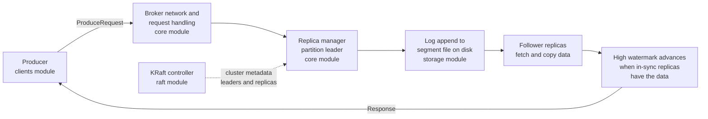
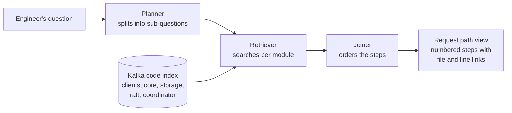
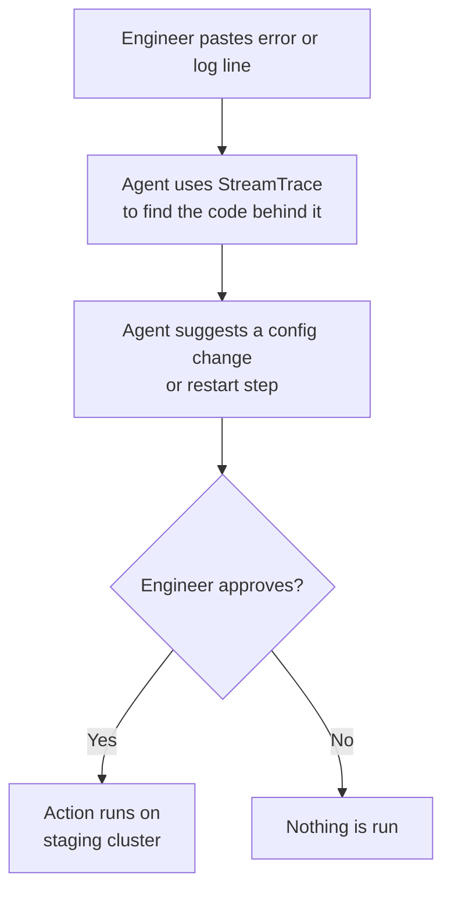

# StreamTrace

Follow a message through a large streaming platform's code, across many modules, in one answer.

## Problem

When Kafka misbehaves at night, the on-call engineer needs to know how a request moves from the client library through the broker to disk. That path spans the clients, core, storage, raft and coordinator modules, and no single file explains it. Today the engineer greps across thousands of files under pressure and pieces the path together by hand. StreamTrace plans the sub-questions, retrieves code per module, and returns one cited answer that follows the request end to end.

## Who it is for

On-call platform engineer at a logistics company in Chennai that runs Apache Kafka for shipment tracking events.

## About Apache Kafka

Apache Kafka is an open-source distributed event streaming platform. Applications called producers write events (for example, a shipment scan) to named topics, and applications called consumers read them. Each topic is split into partitions that are replicated across brokers, so data survives a broker failure. Brokers store events in append-only log files on disk, and a controller quorum (KRaft) manages cluster metadata. The codebase is large and split into modules (clients, core, storage, raft, group coordinator, Connect, Streams), which is why following a single request through it is hard.

The diagram below is a simplified view of a produce request with `acks=all`. StreamTrace's job is to produce the exact version for any question, with a file and line range for each step.



## Signature feature

**Request path view:** a numbered step list from the client call to the disk write, with each step linked to a file and line range.

**Support agent with approvals:** the agent reads an error message or log line from the on-call engineer, uses StreamTrace to find the code that produces it, and suggests a config change or restart step. Any action on the staging cluster (config change, broker restart) runs only after the engineer clicks approve.

## How StreamTrace works (planned design)



## Agent approval flow

The agent never changes the staging cluster on its own. Every action waits for the engineer to click approve.



## Hardest problem (my interview story)

Cross-document comparison. A question like "what happens when a producer sends with acks=all" needs an answer stitched together from 4 to 6 files in different modules. StreamTrace must plan sub-questions, retrieve per module, and join the steps into one cited path.

## Dataset

| Source | Link | Documents | Pages | Licence / terms |
| ------ | ---- | --------- | ----- | --------------- |
| Apache Kafka source code (Java and Scala modules for clients, broker, storage, KRaft, Connect and Streams) | https://github.com/apache/kafka | 6,400+ source files | n/a (source code) | Apache-2.0 |

See [DATASET.md](DATASET.md) for details.

**Attribution:** Apache Kafka is licensed under Apache-2.0. StreamTrace indexes the public Kafka source code but is not affiliated with or endorsed by the Apache Software Foundation. Apache, Apache Kafka and Kafka are trademarks of the Apache Software Foundation.

## 10 real questions

See [docs/QUESTIONS.md](docs/QUESTIONS.md). Examples:

1. Trace what happens inside the broker when a producer sends a batch with acks=all.
2. Which code path triggers a consumer group rebalance when a member stops sending heartbeats?
3. Where is log retention enforced, and what decides which segment gets deleted?

## Success metric

Multi-hop accuracy: 80%+ of 60 cross-module questions answered with a complete and correct step chain, judged against a hand-written answer key.

## Run it

```
python -m venv .venv && source .venv/bin/activate   # Windows: .venv\Scripts\activate
pip install -r requirements-dev.txt
cp .env.example .env                                 # Windows: copy .env.example .env
uvicorn app.main:app --reload
curl localhost:8000/health
```

## Live link

<https://streamtrace-44tq.onrender.com>
